# Rally de la Independencia AR

Lluvia Villanueva

[Repositorio en GitHub](https://github.com/Lluvia-18/dolores_rally)

## Ronda 0 · Preparar el taller

### Paso 0.1 · Proyecto y paquetes

### Paso 0.2 · Estructura del proyecto

## Ronda 1 · Diseña el juego antes de programarlo

### Mini documento de diseño

Juego de realidad aumentada por ubicación para encontrar personajes de la Independencia en Dolores Hidalgo. Incluye radar, indicador de frío o caliente, trivia histórica, puntos, álbum coleccionable y modo demo.

## Ronda 2 · Geometría de la Tierra

### Ciclo 2.1 · ROJO

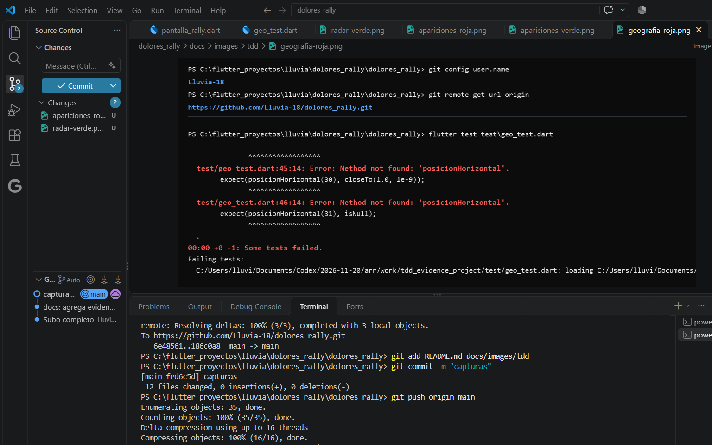

### Ciclo 2.2 · VERDE

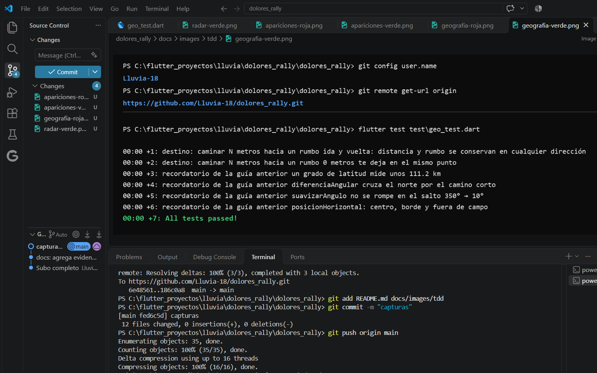

## Ronda 3 · Los personajes y sus preguntas

### Paso 3.1 · Modelo de datos

### Paso 3.2 · Catálogo de personajes de la Independencia

## Ronda 4 · Esconder personajes: azar que se puede probar

### Ciclo 4.1 · ROJO

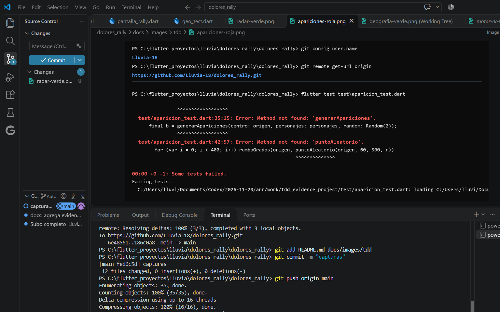

### Ciclo 4.2 · VERDE

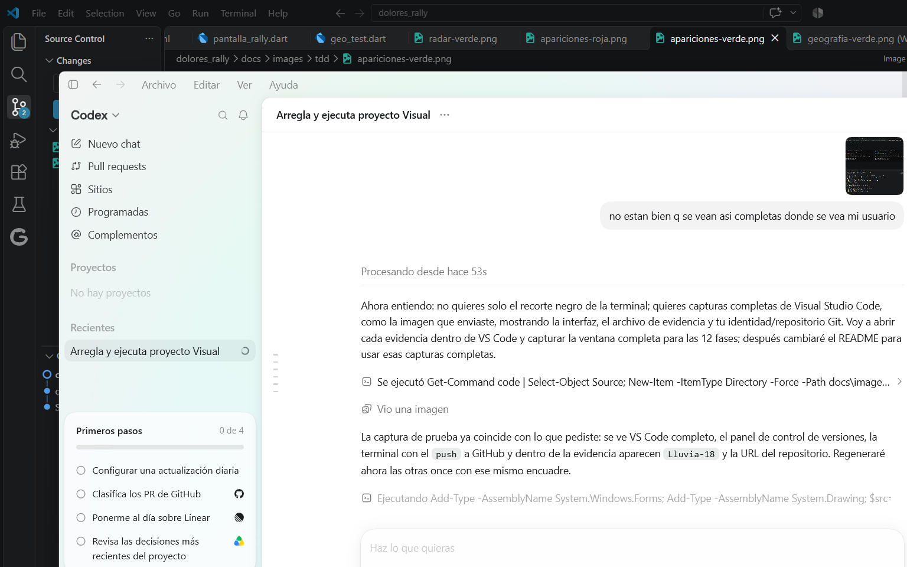

## Ronda 5 · Radar y frío o caliente

### Ciclo 5.1 · ROJO

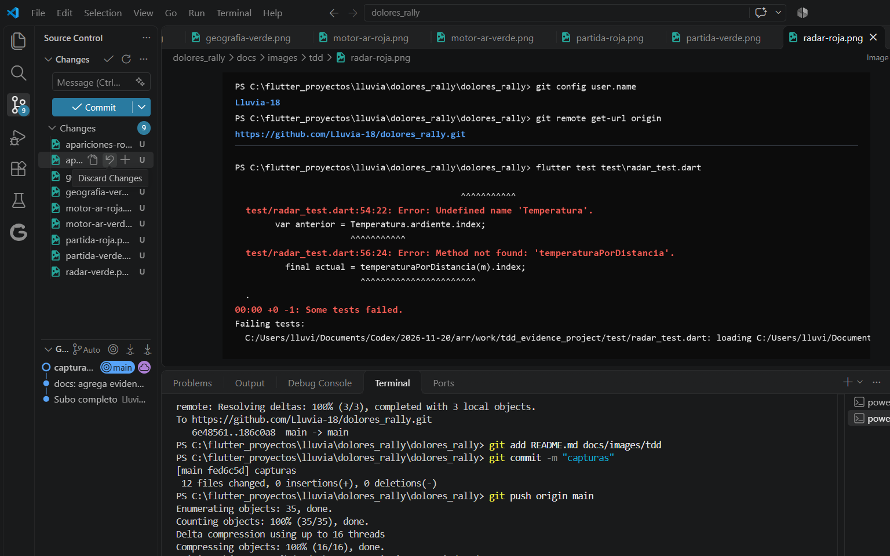

### Ciclo 5.2 · VERDE

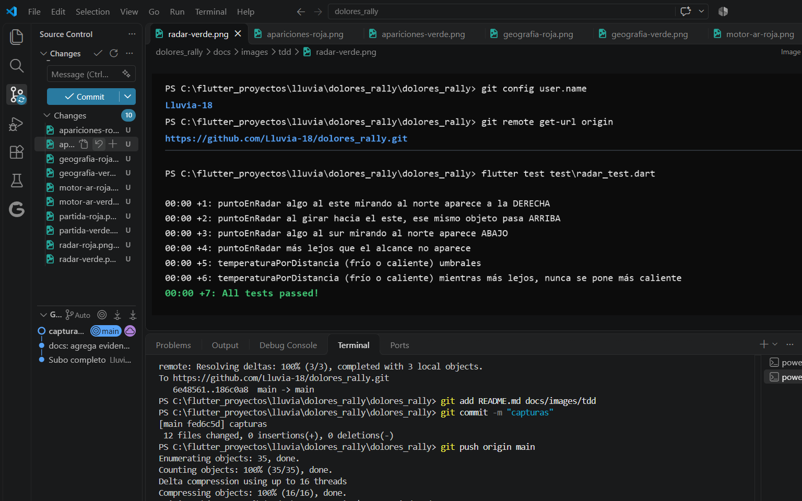

## Ronda 6 · El motor de realidad aumentada

### Ciclo 6.1 · ROJO

### Ciclo 6.2 · VERDE

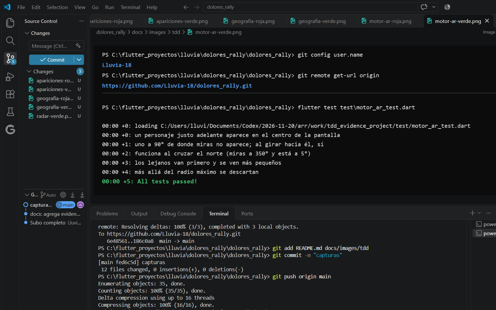

## Ronda 7 · Las reglas del juego

### Ciclo 7.1 · ROJO

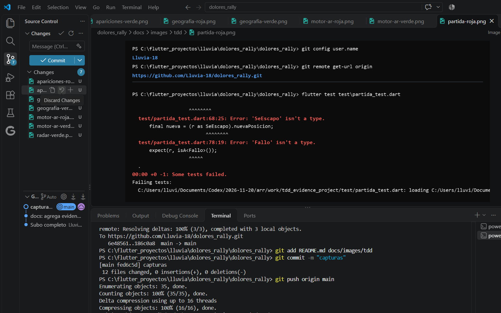

### Ciclo 7.2 · VERDE

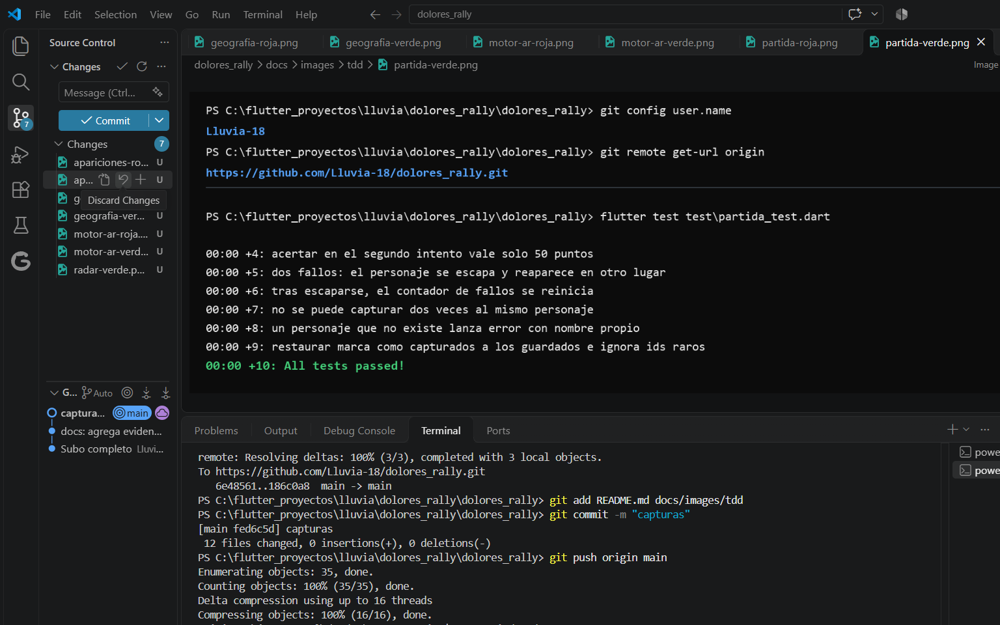

## Ronda 8 · Guardar el progreso

### Paso 8.1 · Contrato de almacenamiento

### Paso 8.2 · Álbum y persistencia

## Ronda 9 · Fuentes de posición y brújula

### Paso 9.1 · Fuentes reales

### Paso 9.2 · Fuentes simuladas para el modo demo

## Ronda 10 · El ViewModel del juego

### Ciclo 10.1 · ROJO

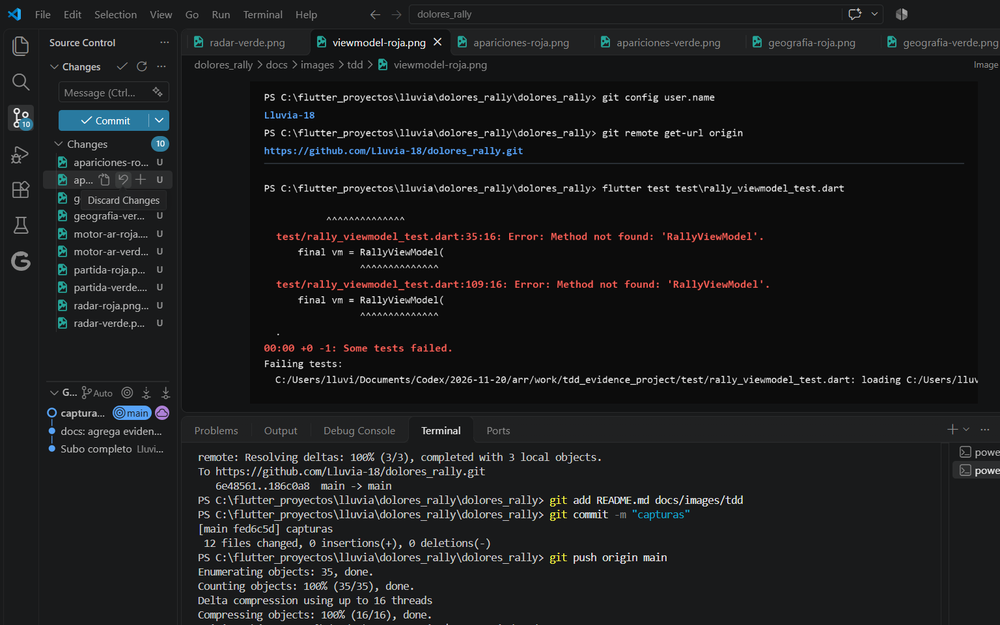

### Ciclo 10.2 · VERDE

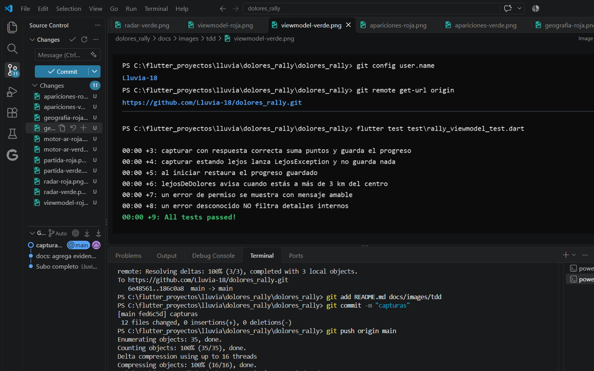

## Ronda 11 · Las pantallas

### Paso 11.1 · Fondo de cámara

### Paso 11.2 · Radar

### Paso 11.3 · Pantalla del rally

### Paso 11.4 · Álbum, inicio y main

## Ronda 12 · Prueba de campo, balanceo y seguridad

### Paso 12.1 · Playtesting

### Paso 12.2 · Permisos, privacidad y seguridad

## Resultado final

- 43 pruebas aprobadas.
- Análisis estático sin errores.
- Aplicación compilada, instalada y ejecutada en Android.
