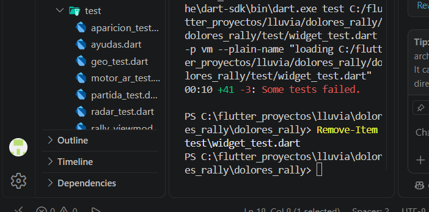
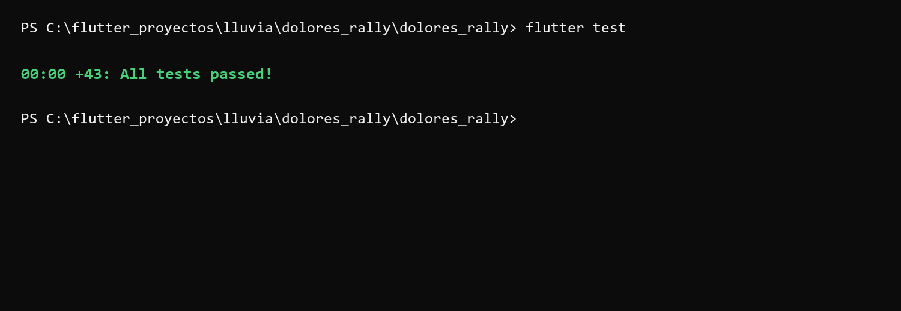

# Rally de la Independencia AR

Aplicación móvil de realidad aumentada y ubicación para recorrer Dolores Hidalgo mientras se encuentran personajes de la Independencia de México. Incluye radar, indicador de frío o caliente, preguntas históricas, puntuación, álbum coleccionable y un modo de demostración que funciona sin GPS.

Proyecto desarrollado con Flutter y Dart aplicando desarrollo guiado por pruebas (TDD).

## Funcionalidades

- Personajes distribuidos alrededor del jugador mediante posiciones reproducibles.
- Radar circular orientado con la brújula.
- Indicador de proximidad: helado, frío, tibio, caliente y ardiendo.
- Captura de personajes a 15 metros o menos.
- Trivia histórica con puntos, intentos y escape del personaje.
- Persistencia del progreso y álbum coleccionable.
- Modo demo para probar el juego sin salir del salón.
- Mensajes seguros para errores de permisos, GPS y sensores.

## Tecnologías

- Flutter 3.47.2 y Dart 3.13.2
- `camera` para la vista de realidad aumentada
- `geolocator` para la ubicación
- `flutter_compass` para el rumbo
- `shared_preferences` para guardar el progreso
- `flutter_test` para las pruebas automatizadas

## Desarrollo con TDD

El proyecto sigue el ciclo indicado en el manual: primero se escribe una prueba que falla (rojo), después se implementa el código mínimo para aprobarla (verde) y finalmente se refactoriza sin romper las pruebas.

### 🔴 Fase roja: la prueba falla

La prueba del radar detectó que el orden interno de las temperaturas no respetaba la regla: al alejarse, la temperatura nunca debe hacerse más caliente. La ejecución terminó con pruebas fallidas, como se esperaba en la fase roja.



Fallo identificado en `temperaturaPorDistancia`: los valores del `enum Temperatura` estaban ordenados de frío a caliente, mientras la prueba compara índices crecientes conforme aumenta la distancia.

### 🟢 Fase verde: todas las pruebas pasan

Se corrigió el orden del `enum` para que aumente con la distancia, conservando los mismos umbrales y nombres. También se añadieron los permisos Android necesarios y se actualizaron llamadas obsoletas del SDK.



Resultado actual:

- 43 pruebas aprobadas.
- 0 pruebas fallidas.
- `flutter analyze` sin problemas.
- APK de depuración compilado e instalado en Android.

## Cobertura funcional de las pruebas

| Archivo | Responsabilidad comprobada |
| --- | --- |
| `geo_test.dart` | Distancias, rumbos, destino y cruce del norte |
| `aparicion_test.dart` | Apariciones, radios y azar reproducible |
| `radar_test.dart` | Orientación del radar y temperatura por distancia |
| `motor_ar_test.dart` | Campo de visión, profundidad y escala |
| `partida_test.dart` | Captura, puntos, intentos, escape y restauración |
| `rally_viewmodel_test.dart` | Integración de sensores, estado, errores y persistencia |

## Estructura del proyecto

```text
lib/
├── dominio/       # Reglas del juego escritas en Dart puro
├── datos/         # GPS, brújula, simuladores y almacenamiento
├── presentacion/  # ViewModel, cámara, radar y pantallas
└── main.dart      # Punto de entrada
test/              # Pruebas automatizadas
docs/images/       # Evidencias de las fases TDD
```

## Cómo ejecutar el proyecto

Requisitos: Flutter estable, Android Studio y un emulador o teléfono Android configurado.

```bash
flutter pub get
flutter analyze
flutter test
flutter run
```

Para ejecutar en el emulador usado durante el desarrollo:

```bash
flutter emulators --launch medium_phone
flutter run -d emulator-5554
```

El identificador `emulator-5554` puede cambiar. Ejecuta `flutter devices` para consultar el identificador vigente.

## Permisos de Android

El manifiesto ya declara:

- Cámara.
- Ubicación precisa y aproximada.
- Cámara y brújula como características opcionales, para permitir el modo demo.

Android solicitará los permisos necesarios al abrir el modo real. Si el emulador no dispone de brújula o ubicación configurada, utiliza el modo demo.

## GitHub

Este directorio todavía no tiene un repositorio Git ni un remoto de GitHub configurado. Para publicarlo por primera vez:

```bash
git init
git add .
git commit -m "feat: Rally de la Independencia AR con TDD"
git branch -M main
git remote add origin https://github.com/TU_USUARIO/dolores-rally.git
git push -u origin main
```

Sustituye `TU_USUARIO` por tu usuario real de GitHub y crea antes un repositorio vacío llamado `dolores-rally`. Después puedes reemplazar este párrafo por el enlace definitivo:

```text
https://github.com/TU_USUARIO/dolores-rally
```

Una estrategia de commits compatible con el ciclo TDD es:

```text
test: agrega prueba de temperatura del radar       # rojo
fix: corrige progresión de temperatura por distancia # verde
refactor: limpia radar sin cambiar comportamiento    # refactor
```

## Nota académica

Los datos históricos y las coordenadas son material de práctica. Antes de usar el juego con estudiantes, deben validarse con fuentes locales como museos, archivos históricos o cronistas de Dolores Hidalgo.
