# Rally de la Independencia AR

Aplicación móvil de realidad aumentada y ubicación para recorrer Dolores Hidalgo mientras se encuentran personajes de la Independencia de México. Incluye radar, indicador de frío o caliente, preguntas históricas, puntuación, álbum coleccionable y un modo de demostración que funciona sin GPS.

Proyecto desarrollado con Flutter y Dart aplicando desarrollo guiado por pruebas (TDD).

## Funcionalidades

- Personajes distribuidos alrededor del jugador mediante posiciones reproducibles.
- Radar circular orientado con la brújula.
- Indicador de proximidad: helado, frío, tibio, caliente y ardiendo.
- Captura de personajes a 15 metros o menos.
- Trivia histórica con puntos, intentos y escape del personaje.
- Persistencia del progreso y álbum coleccionable.
- Modo demo para probar el juego sin salir del salón.
- Mensajes seguros para errores de permisos, GPS y sensores.

## Tecnologías

- Flutter 3.47.2 y Dart 3.13.2
- `camera` para la vista de realidad aumentada
- `geolocator` para la ubicación
- `flutter_compass` para el rumbo
- `shared_preferences` para guardar el progreso
- `flutter_test` para las pruebas automatizadas

## Desarrollo con TDD

El proyecto sigue el ciclo indicado en el manual: primero se escribe una prueba que falla (rojo), después se implementa el código mínimo para aprobarla (verde) y finalmente se refactoriza sin romper las pruebas.

Las capturas rojas se obtuvieron ejecutando cada prueba antes de disponer de su archivo de implementación, en una copia temporal aislada. Las capturas verdes corresponden a la misma prueba ejecutada con la implementación actual. El código del repositorio no se modificó para simular los fallos.

### Ciclo 2 - Geografía y destino

La prueba define distancia, rumbo, normalización de ángulos, posición horizontal y el cálculo del punto de destino. En rojo, `geo.dart` todavía no está disponible; en verde, todos los cálculos geográficos cumplen los casos normales y de frontera.

#### 🔴 Roja

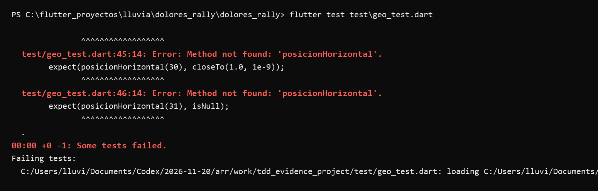

#### 🟢 Verde

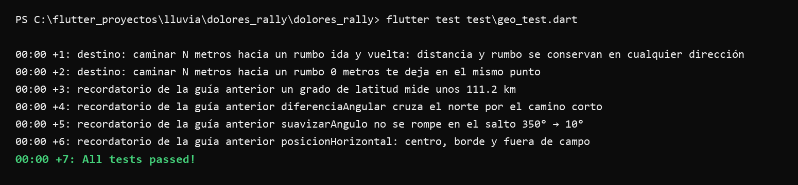

### Ciclo 4 - Apariciones aleatorias

Se comprueba que exista una aparición por personaje, que todas queden dentro del radio permitido, que una semilla repita resultados y que los puntos se distribuyan en todas las direcciones.

#### 🔴 Roja

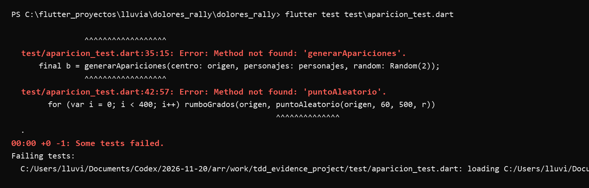

#### 🟢 Verde

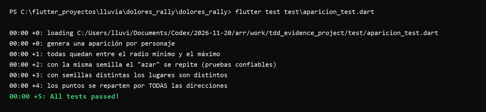

### Ciclo 5 - Radar y temperatura

Las pruebas verifican la orientación del radar, el alcance y la progresión de frío a caliente. Durante el desarrollo también permitieron detectar y corregir el orden interno del `enum Temperatura`.

#### 🔴 Roja

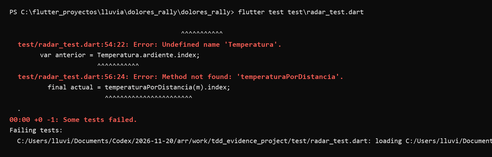

#### 🟢 Verde

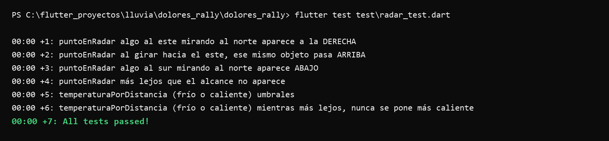

### Ciclo 6 - Motor de realidad aumentada

Se valida qué personajes están dentro del campo de visión, su posición horizontal, profundidad, escala, orden de dibujo y el cruce correcto del norte entre 350° y 5°.

#### 🔴 Roja

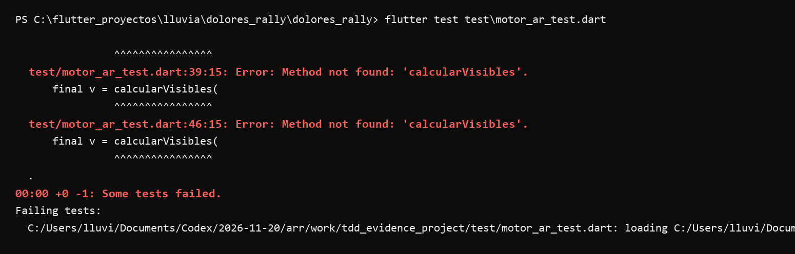

#### 🟢 Verde

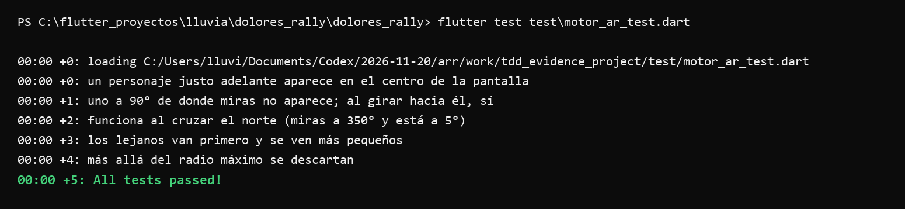

### Ciclo 7 - Reglas de la partida

Las pruebas especifican captura, distancia máxima, puntos, respuestas incorrectas, escape, reaparición, restauración y protección contra capturas duplicadas.

#### 🔴 Roja

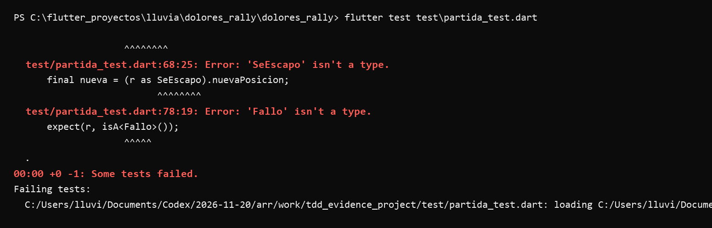

#### 🟢 Verde

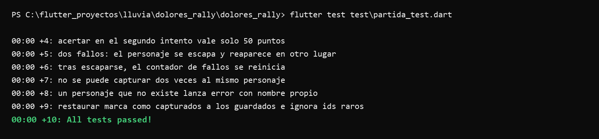

### Ciclo 10 - ViewModel e integración

Se integran fuentes de GPS y brújula, cálculo de elementos visibles, temperatura, captura, persistencia, restauración y mensajes seguros ante errores.

#### 🔴 Roja

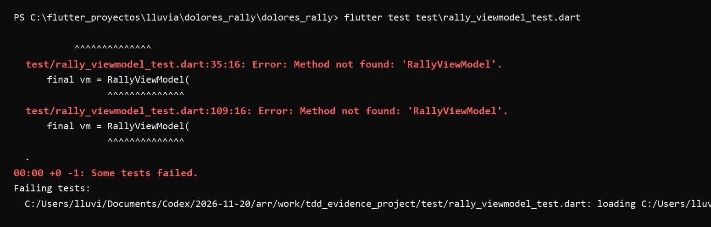

#### 🟢 Verde

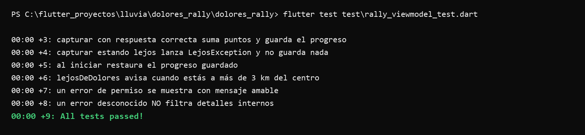

### Estado final

Resultado actual:

- 43 pruebas aprobadas.
- 0 pruebas fallidas.
- `flutter analyze` sin problemas.
- APK de depuración compilado e instalado en Android.

## Cobertura funcional de las pruebas

| Archivo | Responsabilidad comprobada |
| --- | --- |
| `geo_test.dart` | Distancias, rumbos, destino y cruce del norte |
| `aparicion_test.dart` | Apariciones, radios y azar reproducible |
| `radar_test.dart` | Orientación del radar y temperatura por distancia |
| `motor_ar_test.dart` | Campo de visión, profundidad y escala |
| `partida_test.dart` | Captura, puntos, intentos, escape y restauración |
| `rally_viewmodel_test.dart` | Integración de sensores, estado, errores y persistencia |

## Estructura del proyecto

```text
lib/
├── dominio/       # Reglas del juego escritas en Dart puro
├── datos/         # GPS, brújula, simuladores y almacenamiento
├── presentacion/  # ViewModel, cámara, radar y pantallas
└── main.dart      # Punto de entrada
test/              # Pruebas automatizadas
docs/images/       # Evidencias de las fases TDD
```

## Cómo ejecutar el proyecto

Requisitos: Flutter estable, Android Studio y un emulador o teléfono Android configurado.

```bash
flutter pub get
flutter analyze
flutter test
flutter run
```

Para ejecutar en el emulador usado durante el desarrollo:

```bash
flutter emulators --launch medium_phone
flutter run -d emulator-5554
```

El identificador `emulator-5554` puede cambiar. Ejecuta `flutter devices` para consultar el identificador vigente.

## Permisos de Android

El manifiesto ya declara:

- Cámara.
- Ubicación precisa y aproximada.
- Cámara y brújula como características opcionales, para permitir el modo demo.

Android solicitará los permisos necesarios al abrir el modo real. Si el emulador no dispone de brújula o ubicación configurada, utiliza el modo demo.

## GitHub

[Repositorio del proyecto en GitHub](https://github.com/Lluvia-18/dolores_rally)

Para subir estas nuevas evidencias y la actualización del README:

```bash
git add README.md docs/images/tdd
git commit -m "docs: agrega evidencias de todas las fases TDD"
git push origin main
```

Una estrategia de commits compatible con el ciclo TDD es:

```text
test: agrega prueba de temperatura del radar       # rojo
fix: corrige progresión de temperatura por distancia # verde
refactor: limpia radar sin cambiar comportamiento    # refactor
```

## Nota académica

Los datos históricos y las coordenadas son material de práctica. Antes de usar el juego con estudiantes, deben validarse con fuentes locales como museos, archivos históricos o cronistas de Dolores Hidalgo.
